# Avaliação 02 - Relatório de evidências

Estudante: Isaque Medeiros Lopes
Turma: 4º Semestre  Data: 02/06/2026
Identificador AV02_ID: isaque-lopes   
Porta utilizada: 8182

## E01 - Preparação / configuração válida
- Comandos executados:
- Saída relevante (retire qualquer senha real):
- Evidência anexada: E01_....png
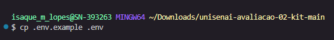
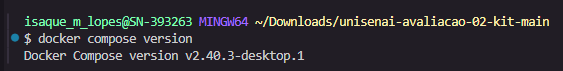
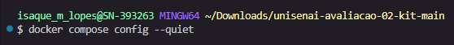
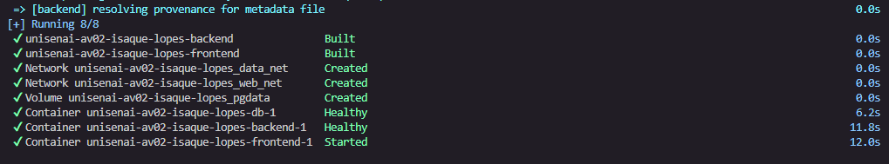
$ docker compose up -d --build
[+] Building 13.8s (23/23) FINISHED                                                                                                             
 => [internal] load local bake definitions                                                                                                 0.0s
 => => reading from stdin 1.22kB                                                                                                           0.0s
 => [backend internal] load build definition from Dockerfile                                                                               0.1s
 => => transferring dockerfile: 467B                                                                                                       0.0s
 => [frontend internal] load build definition from Dockerfile                                                                              0.1s
 => => transferring dockerfile: 258B                                                                                                       0.0s
 => [frontend internal] load metadata for docker.io/library/nginx:1.27-alpine                                                              1.9s
 => [backend internal] load metadata for docker.io/library/python:3.12-slim                                                                1.9s
 => [frontend internal] load .dockerignore                                                                                                 0.1s
 => => transferring context: 2B                                                                                                            0.0s
 => [backend internal] load .dockerignore                                                                                                  0.1s
 => => transferring context: 69B                                                                                                           0.0s
 => [frontend 1/5] FROM docker.io/library/nginx:1.27-alpine@sha256:65645c7bb6a0661892a8b03b89d0743208a18dd2f3f17a54ef4b76fb8e2f2a10        2.9s
 => => resolve docker.io/library/nginx:1.27-alpine@sha256:65645c7bb6a0661892a8b03b89d0743208a18dd2f3f17a54ef4b76fb8e2f2a10                 0.1s
 => => sha256:39c2ddfd6010082a4a646e7ca44e95aca9bf3eaebc00f17f7ccc2954004f2a7d 15.52MB / 15.52MB                                           1.2s
 => => sha256:34a64644b756511a2e217f0508e11d1a572085d66cd6dc9a555a082ad49a3102 1.40kB / 1.40kB                                             0.4s
 => => sha256:197eb75867ef4fcecd4724f17b0972ab0489436860a594a9445f8eaff8155053 1.21kB / 1.21kB                                             0.2s
 => => sha256:81bd8ed7ec6789b0cb7f1b47ee731c522f6dba83201ec73cd6bca1350f582948 402B / 402B                                                 0.2s
 => => sha256:d7e5070240863957ebb0b5a44a5729963c3462666baa2947d00628cb5f2d5773 955B / 955B                                                 0.2s
 => => sha256:b464cfdf2a6319875aeb27359ec549790ce14d8214fcb16ef915e4530e5ed235 629B / 629B                                                 0.2s
 => => sha256:61ca4f733c802afd9e05a32f0de0361b6d713b8b53292dc15fb093229f648674 1.79MB / 1.79MB                                             0.4s
 => => sha256:f18232174bc91741fdf3da96d85011092101a032a93a388b79e99e69c2d5c870 3.64MB / 3.64MB                                             0.4s
 => => extracting sha256:f18232174bc91741fdf3da96d85011092101a032a93a388b79e99e69c2d5c870                                                  0.1s
 => => extracting sha256:61ca4f733c802afd9e05a32f0de0361b6d713b8b53292dc15fb093229f648674                                                  0.1s
 => => extracting sha256:b464cfdf2a6319875aeb27359ec549790ce14d8214fcb16ef915e4530e5ed235                                                  0.0s
 => => extracting sha256:d7e5070240863957ebb0b5a44a5729963c3462666baa2947d00628cb5f2d5773                                                  0.0s
 => => extracting sha256:81bd8ed7ec6789b0cb7f1b47ee731c522f6dba83201ec73cd6bca1350f582948                                                  0.0s
 => => extracting sha256:197eb75867ef4fcecd4724f17b0972ab0489436860a594a9445f8eaff8155053                                                  0.0s
 => => extracting sha256:34a64644b756511a2e217f0508e11d1a572085d66cd6dc9a555a082ad49a3102                                                  0.0s
 => => extracting sha256:39c2ddfd6010082a4a646e7ca44e95aca9bf3eaebc00f17f7ccc2954004f2a7d                                                  0.2s
 => [frontend internal] load build context                                                                                                 0.2s
 => => transferring context: 4.50kB                                                                                                        0.0s
 => [backend 1/5] FROM docker.io/library/python:3.12-slim@sha256:5e2bdb1b0d542d5039cffb8181c65930093949194a65c365dfb1b0fe13a4fa5b          6.0s
 => => resolve docker.io/library/python:3.12-slim@sha256:5e2bdb1b0d542d5039cffb8181c65930093949194a65c365dfb1b0fe13a4fa5b                  0.1s
 => => sha256:68bced9e0afa4479df17c3646e27c7c7e9ce9ba70c0e6c73b6826487b89037d9 1.29MB / 1.29MB                                             0.3s
 => => sha256:05e0eee5572e9c9f50408a2132590133b830a668a1cf2ff2b150f19c57707e2b 248B / 248B                                                 0.3s
 => => sha256:2dc99d2d0a39fce31e37615eb4c932e16dcc4c2b0ce9993714280081b5dbe085 12.12MB / 12.12MB                                           1.2s
 => => sha256:37fb86c2a767b88d500c6872195f88078f64765fe0d2f9cc375cc2efbd4c0a41 29.86MB / 29.86MB                                           4.7s
 => => extracting sha256:37fb86c2a767b88d500c6872195f88078f64765fe0d2f9cc375cc2efbd4c0a41                                                  0.5s
 => => extracting sha256:68bced9e0afa4479df17c3646e27c7c7e9ce9ba70c0e6c73b6826487b89037d9                                                  0.1s
 => => extracting sha256:2dc99d2d0a39fce31e37615eb4c932e16dcc4c2b0ce9993714280081b5dbe085                                                  0.3s
 => => extracting sha256:05e0eee5572e9c9f50408a2132590133b830a668a1cf2ff2b150f19c57707e2b                                                  0.0s
 => [backend internal] load build context                                                                                                  0.2s
 => => transferring context: 2.53kB                                                                                                        0.0s
 => [frontend 2/5] COPY nginx.conf /etc/nginx/conf.d/default.conf                                                                          0.2s
 => [frontend 3/5] COPY index.html /usr/share/nginx/html/index.html                                                                        0.1s
 => [frontend 4/5] COPY styles.css /usr/share/nginx/html/styles.css                                                                        0.1s
 => [frontend 5/5] COPY app.js /usr/share/nginx/html/app.js                                                                                0.1s
 => [frontend] exporting to image                                                                                                          0.8s
 => => exporting layers                                                                                                                    0.4s
 => => exporting manifest sha256:3635d7681594d86785ee2cc239e35291f6300114f6aed6bd2140905ea134dd01                                          0.0s
 => => exporting config sha256:ff39cad66a0c864ee832f09da5cdd58cfc65d2ddc7e3532c62b4280a455e3173                                            0.0s
 => => exporting attestation manifest sha256:bedfe8ba2581dccd72fb8ba7fc709ab5ecd1b9668a814ee77fe478ef96c28996                              0.1s
 => => exporting manifest list sha256:4f708f199c89ce705fe0e077e787acb16ac00e46e027035ef85db2a897d1412e                                     0.0s
 => => naming to docker.io/library/unisenai-av02-isaque-lopes-frontend:latest                                                              0.0s
 => => unpacking to docker.io/library/unisenai-av02-isaque-lopes-frontend:latest                                                           0.1s
 => [frontend] resolving provenance for metadata file                                                                                      0.0s
 => [backend 2/5] WORKDIR /app                                                                                                             0.4s
 => [backend 3/5] COPY requirements.txt ./                                                                                                 0.1s
 => [backend 4/5] RUN pip install --no-cache-dir -r requirements.txt     && groupadd --system app     && useradd --system --gid app --no-  3.4s
 => [backend 5/5] COPY --chown=app:app app.py ./                                                                                           0.1s
 => [backend] exporting to image                                                                                                           1.3s
 => => exporting layers                                                                                                                    0.8s
 => => exporting manifest sha256:79c4f13484ff9871225e1ed5e2908a8586f17a0c4db59864fa6bc32f46c9e5d2                                          0.0s
 => => exporting config sha256:2afbff51638948aaa43782be766c60af02570ec06183236157badd2fcf3cac66                                            0.0s
 => => exporting attestation manifest sha256:1802d32675de132b985d3196364e7dcd03f5487fef43961f3e8a681f31aa1e16                              0.1s
 => => exporting manifest list sha256:7006295840748917a34aa817dcccb33c2b74bb8fd6ee4f2b293c21fae35a3d08                                     0.0s
 => => naming to docker.io/library/unisenai-av02-isaque-lopes-backend:latest                                                               0.0s
 => => unpacking to docker.io/library/unisenai-av02-isaque-lopes-backend:latest                                                            0.2s
 => [backend] resolving provenance for metadata file                                                                                       0.0s
[+] Running 8/8
 ✔ unisenai-av02-isaque-lopes-backend               Built                                                                                  0.0s 
 ✔ unisenai-av02-isaque-lopes-frontend              Built                                                                                  0.0s 
 ✔ Network unisenai-av02-isaque-lopes_data_net      Created                                                                                0.0s 
 ✔ Network unisenai-av02-isaque-lopes_web_net       Created                                                                                0.0s 
 ✔ Volume unisenai-av02-isaque-lopes_pgdata         Created                                                                                0.0s 
 ✔ Container unisenai-av02-isaque-lopes-db-1        Healthy                                                                                6.2s 
 ✔ Container unisenai-av02-isaque-lopes-backend-1   Healthy                                                                               11.8s 
 ✔ Container unisenai-av02-isaque-lopes-frontend-1  Started                                                                               12.0s 
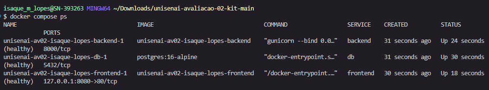

## E02 - Configuração segura do Compose
- Alterações no compose.yaml e .env.example:
- Como conferi que backend e db não publicam portas no host:
- Evidência anexada:
compose.yaml:
name: unisenai-av02-${AV02_ID:-aluno}

services:
  frontend:
    build: ./frontend
    ports:
      - "127.0.0.1:${APP_PORT:-8080}:80"
    networks:
      - web_net
    depends_on:
      backend:
        condition: service_healthy
    restart: unless-stopped
    security_opt:
      - no-new-privileges:true
    cap_drop:
      - ALL
    cap_add:
      - CHOWN
      - SETGID
      - SETUID
    healthcheck:
      test: ["CMD-SHELL", "wget -q -O /dev/null http://127.0.0.1/ || exit 1"]
      interval: 10s
      timeout: 3s
      retries: 5
      start_period: 10s

  backend:
    build: ./backend
    pids_limit: 100
    mem_limit: 256m
    environment:
      DATABASE_URL: "postgresql://${POSTGRES_USER}:${POSTGRES_PASSWORD}@db:5432/${POSTGRES_DB}"
    expose:
      - "8000"
    networks:
      - web_net
      - data_net
    depends_on:
      db:
        condition: service_healthy
    restart: unless-stopped
    security_opt:
      - no-new-privileges:true
    cap_drop:
      - ALL
    healthcheck:
      test: ["CMD", "python", "-c", "import urllib.request; urllib.request.urlopen('http://127.0.0.1:8000/api/health', timeout=3)"]
      interval: 10s
      timeout: 5s
      retries: 6
      start_period: 15s

  db:
    image: postgres:16-alpine
    environment:
      POSTGRES_USER: ${POSTGRES_USER}
      POSTGRES_PASSWORD: ${POSTGRES_PASSWORD}
      POSTGRES_DB: ${POSTGRES_DB}
    networks:
      - data_net
    volumes:
      - pgdata:/var/lib/postgresql/data
      - ./db/init.sql:/docker-entrypoint-initdb.d/01-init.sql:ro
    restart: unless-stopped
    security_opt:
      - no-new-privileges:true
    cap_drop:
      - ALL
    cap_add:
      - CHOWN
      - DAC_OVERRIDE
      - FOWNER
      - SETGID
      - SETUID
    healthcheck:
      test: ["CMD-SHELL", "pg_isready -U \"$${POSTGRES_USER}\" -d \"$${POSTGRES_DB}\""]
      interval: 5s
      timeout: 3s
      retries: 12
      start_period: 15s

networks:
  web_net:
    driver: bridge
  data_net:
    driver: bridge
    internal: true

volumes:
  pgdata:

.env.exemple:
AV02_ID=aluno
APP_PORT=8182
POSTGRES_USER=aluno
POSTGRES_PASSWORD=senha_local_exclusiva_aula13
POSTGRES_DB=unisenai

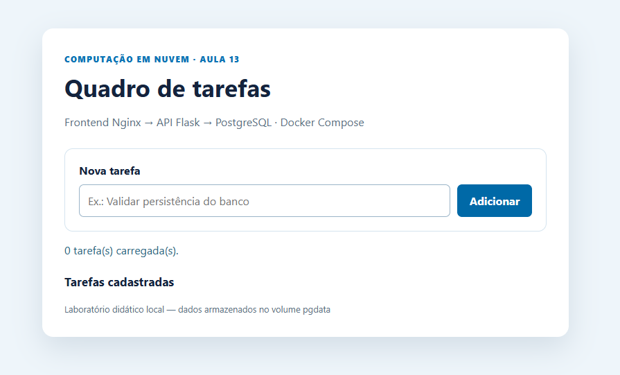

A stack usa duas redes para separar o que fica exposto do que fica protegido:

web_net liga frontend e backend. O frontend é o único serviço que publica porta no host (127.0.0.1:8182), e só na interface local.
data_net liga backend e db. Ela é internal: true, então não tem saída para fora do Docker nem acesso pelo host.
O backend participa das duas redes e faz a ponte: recebe requisições do frontend e consulta o db. O frontend não está na data_net, então não enxerga o banco. Se alguém comprometer o frontend, ainda precisa passar pelo backend para chegar ao db. O db também não publica a porta 5432, então nada de fora do Docker o alcança diretamente.

## E03 - Liveness, readiness e healthcheck
- Respostas HTTP normais observadas:
- Arquivos alterados:
- Evidência anexada:

app.py
"""API educacional para demonstrar comunicação HTTP + PostgreSQL via Docker Compose."""
import logging
import os

from flask import Flask, jsonify, request
import psycopg
from psycopg.rows import dict_row

app = Flask(__name__)
logger = logging.getLogger(__name__)

def db_connect():
    return psycopg.connect(
        os.environ["DATABASE_URL"], connect_timeout=3, row_factory=dict_row
    )

@app.get("/api/live")
def live():
    return jsonify(status="alive"), 200

@app.get("/api/health")
def health():
    try:
        with db_connect() as conn:
            with conn.cursor() as cur:
                cur.execute("SELECT 1")
                cur.fetchone()
        return jsonify(status="ok", database="ok"), 200
    except psycopg.Error:
        logger.exception("Database healthcheck failed")
        return jsonify(status="degraded", database="unavailable"), 503

@app.get("/api/ready")
def ready():
    return health()

@app.get("/api/tasks")
def list_tasks():
    try:
        with db_connect() as conn:
            with conn.cursor() as cur:
                cur.execute(
                    "SELECT id, titulo, criada_em FROM tarefas "
                    "ORDER BY id DESC LIMIT 100"
                )
                rows = cur.fetchall()
        return jsonify([
            {"id": row["id"], "titulo": row["titulo"],
             "criada_em": row["criada_em"].isoformat()}
            for row in rows
        ]), 200
    except psycopg.Error:
        logger.exception("Could not list tasks")
        return jsonify(erro="Banco indisponível; tente novamente"), 503

@app.post("/api/tasks")
def create_task():
    data = request.get_json(silent=True)
    if not isinstance(data, dict):
        return jsonify(erro="Envie um objeto JSON"), 400
    title = data.get("titulo", "")
    if not isinstance(title, str):
        return jsonify(erro="O campo 'titulo' deve ser texto"), 400
    title = title.strip()
    if not 1 <= len(title) <= 120:
        return jsonify(erro="Título obrigatório: entre 1 e 120 caracteres"), 400
    try:
        with db_connect() as conn:
            with conn.cursor() as cur:
                cur.execute(
                    "INSERT INTO tarefas (titulo) VALUES (%s) RETURNING id",
                    (title,),
                )
                task_id = cur.fetchone()["id"]
        return jsonify(id=task_id, titulo=title), 201
    except psycopg.Error:
        logger.exception("Could not create task")
        return jsonify(erro="Banco indisponível; tente novamente"), 503

isaque_m_lopes@SN-393263 MINGW64 ~/Downloads/unisenai-avaliacao-02-kit-main
$ docker compose up -d --build backend
[+] Building 1.2s (12/12) FINISHED                                                                                                               
 => [internal] load local bake definitions                                                                                                  0.0s
 => => reading from stdin 650B                                                                                                              0.0s
 => [internal] load build definition from Dockerfile                                                                                        0.0s
 => => transferring dockerfile: 467B                                                                                                        0.0s
 => [internal] load metadata for docker.io/library/python:3.12-slim                                                                         0.6s
 => [internal] load .dockerignore                                                                                                           0.0s
 => => transferring context: 69B                                                                                                            0.0s
 => [1/5] FROM docker.io/library/python:3.12-slim@sha256:5e2bdb1b0d542d5039cffb8181c65930093949194a65c365dfb1b0fe13a4fa5b                   0.0s
 => => resolve docker.io/library/python:3.12-slim@sha256:5e2bdb1b0d542d5039cffb8181c65930093949194a65c365dfb1b0fe13a4fa5b                   0.0s
 => [internal] load build context                                                                                                           0.0s
 => => transferring context: 63B                                                                                                            0.0s
 => CACHED [2/5] WORKDIR /app                                                                                                               0.0s
 => CACHED [3/5] COPY requirements.txt ./                                                                                                   0.0s
 => CACHED [4/5] RUN pip install --no-cache-dir -r requirements.txt     && groupadd --system app     && useradd --system --gid app --no-cr  0.0s
 => CACHED [5/5] COPY --chown=app:app app.py ./                                                                                             0.0s
 => exporting to image                                                                                                                      0.2s
 => => exporting layers                                                                                                                     0.0s
 => => exporting manifest sha256:ef4ea219110a062e9496a0dd6205573768b17956e61c88bf5fe32b756b10aaa0                                           0.0s
 => => exporting config sha256:d27a205dc703e23362829d41a16e53a1f18b3d3852c18244419b54a50b003863                                             0.0s
 => => exporting attestation manifest sha256:6a2315ac076d3326a36918a163f70d694367de233084a1148eae2735ecd3fbe6                               0.1s
 => => exporting manifest list sha256:e08d00e4ecda5bae24aeb765d773eed1b391cbc38a212799e3a65c4a4b8ef3e1                                      0.0s
 => => naming to docker.io/library/unisenai-av02-isaque-lopes-backend:latest                                                                0.0s
 => => unpacking to docker.io/library/unisenai-av02-isaque-lopes-backend:latest                                                             0.0s
 => resolving provenance for metadata file                                                                                                  0.0s
[+] Running 3/3
 ✔ unisenai-av02-isaque-lopes-backend              Built                                                                                    0.0s 
 ✔ Container unisenai-av02-isaque-lopes-db-1       Healthy                                                                                  1.2s 
 ✔ Container unisenai-av02-isaque-lopes-backend-1  Started                                                                                  1.5s 

isaque_m_lopes@SN-393263 MINGW64 ~/Downloads/unisenai-avaliacao-02-kit-main
$ docker compose restart frontend
[+] Restarting 1/1
 ✔ Container unisenai-av02-isaque-lopes-frontend-1  Started                                                                                 0.6s 

isaque_m_lopes@SN-393263 MINGW64 ~/Downloads/unisenai-avaliacao-02-kit-main
$ curl -i http://127.0.0.1:8182/api/live
HTTP/1.1 200 OK
Server: nginx/1.27.5
Date: Wed, 18 Nov 2026 23:35:15 GMT
Content-Type: application/json
Content-Length: 19
Connection: keep-alive

{"status":"alive"}

isaque_m_lopes@SN-393263 MINGW64 ~/Downloads/unisenai-avaliacao-02-kit-main
$ curl -i http://127.0.0.1:8182/api/ready
HTTP/1.1 200 OK
Server: nginx/1.27.5
Date: Wed, 18 Nov 2026 23:35:21 GMT
Content-Type: application/json
Content-Length: 32
Connection: keep-alive

{"database":"ok","status":"ok"}

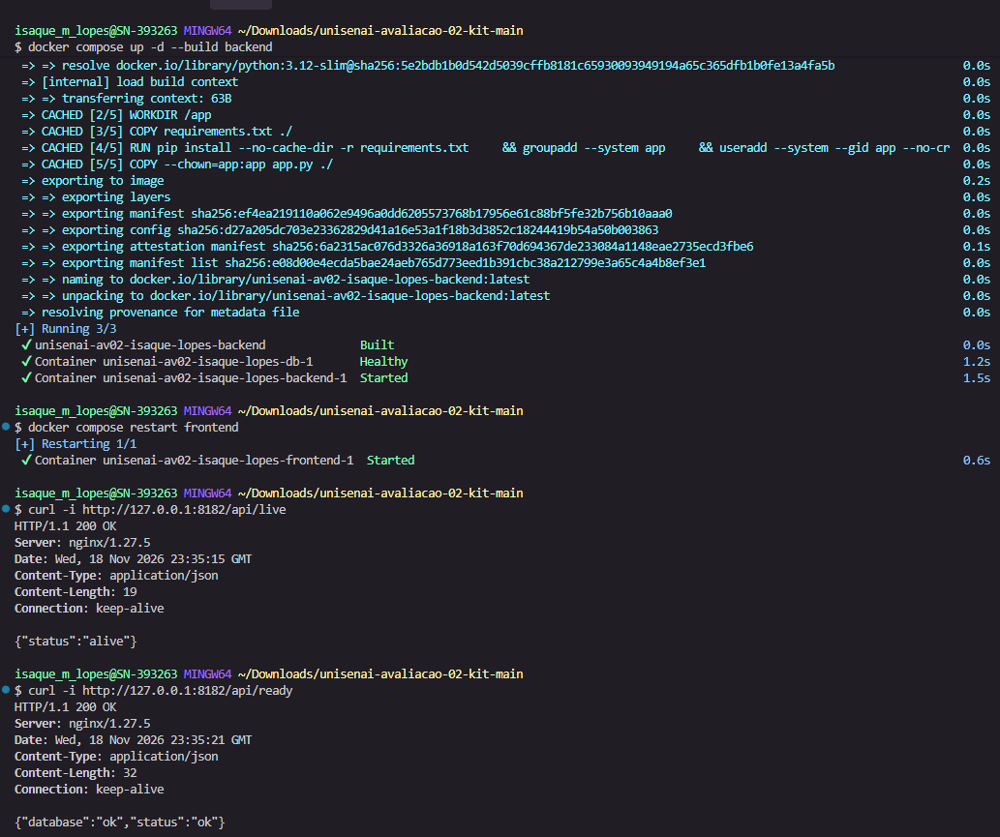

## E04 - Integração
- Título único da tarefa: AV02-isaque-lopes-integracao
- POST: código HTTP e trecho da resposta:
- GET ou tela da tarefa:
- Caminho da requisição browser > ... > banco:

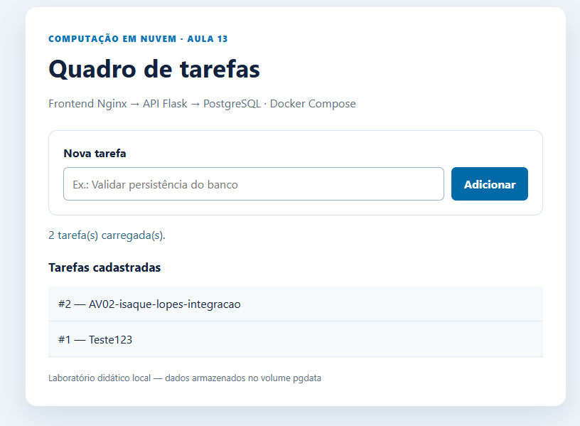
Requisição: POST /api/tasks com {"titulo":"AV02-isaque-lopes-integracao"} 
Resultado: HTTP 201, {"id":2,"titulo":"AV02-isaque-lopes-integracao"}

Requisição: GET /api/tasks	
Resultado: HTTP 200

Requisição: GET /	
Resultado: HTTP 200

1. Navegador (host): 127.0.0.1:8182  (porta publicada) 
   |
   V
2. frontend (nginx, porta 80) rede web_net: location /api/  →  proxy_pass http://backend:8000
   │  
   V
3. backend (Flask/gunicorn, porta 8000) redes web_net + data_net: DATABASE_URL = postgresql://USER:SENHA@db:5432/BANCO
   │  
   V
db (PostgreSQL, porta 5432) rede data_net (internal)

frontend-1  | 172.22.0.1 - - [18/Nov/2026:23:40:08 +0000] "POST /api/tasks HTTP/1.1" 201 74 "-" "Mozilla/5.0 (Windows NT; Windows NT 10.0; pt-BR) WindowsPowerShell/5.1.26100.9711" "-"
frontend-1  | 172.22.0.1 - - [18/Nov/2026:23:40:08 +0000] "GET /api/tasks HTTP/1.1" 200 174 "-" "Mozilla/5.0 (Windows NT; Windows NT 10.0; pt-BR) WindowsPowerShell/5.1.26100.9711" "-"
frontend-1  | 172.22.0.1 - - [18/Nov/2026:23:40:08 +0000] "GET / HTTP/1.1" 200 1138 "-" "Mozilla/5.0 (Windows NT; Windows NT 10.0; pt-BR) WindowsPowerShell/5.1.26100.9711" "-"
frontend-1  | 127.0.0.1 - - [18/Nov/2026:23:40:09 +0000] "GET / HTTP/1.1" 200 1138 "-" "Wget" "-"
frontend-1  | 127.0.0.1 - - [18/Nov/2026:23:40:19 +0000] "GET / HTTP/1.1" 200 1138 "-" "Wget" "-"
frontend-1  | 127.0.0.1 - - [18/Nov/2026:23:40:29 +0000] "GET / HTTP/1.1" 200 1138 "-" "Wget" "-"
frontend-1  | 172.22.0.1 - - [18/Nov/2026:23:40:37 +0000] "GET / HTTP/1.1" 304 0 "-" "Mozilla/5.0 (Windows NT 10.0; Win64; x64) AppleWebKit/537.36 (KHTML, like Gecko) Chrome/157.0.0.0 Safari/537.36" "-"
frontend-1  | 172.22.0.1 - - [18/Nov/2026:23:40:37 +0000] "GET /styles.css HTTP/1.1" 304 0 "http://127.0.0.1:8182/" "Mozilla/5.0 (Windows NT 10.0; Win64; x64) AppleWebKit/537.36 (KHTML, like Gecko) Chrome/157.0.0.0 Safari/537.36" "-"
frontend-1  | 172.22.0.1 - - [18/Nov/2026:23:40:37 +0000] "GET /app.js HTTP/1.1" 304 0 "http://127.0.0.1:8182/" "Mozilla/5.0 (Windows NT 10.0; Win64; x64) AppleWebKit/537.36 (KHTML, like Gecko) Chrome/157.0.0.0 Safari/537.36" "-"
frontend-1  | 172.22.0.1 - - [18/Nov/2026:23:40:37 +0000] "GET /favicon.ico HTTP/1.1" 304 0 "http://127.0.0.1:8182/" "Mozilla/5.0 (Windows NT 10.0; Win64; x64) AppleWebKit/537.36 (KHTML, like Gecko) Chrome/157.0.0.0 Safari/537.36" "-"
frontend-1  | 172.22.0.1 - - [18/Nov/2026:23:40:37 +0000] "GET /api/tasks HTTP/1.1" 200 174 "http://127.0.0.1:8182/" "Mozilla/5.0 (Windows NT 10.0; Win64; x64) AppleWebKit/537.36 (KHTML, like Gecko) Chrome/157.0.0.0 Safari/537.36" "-"
frontend-1  | 127.0.0.1 - - [18/Nov/2026:23:40:39 +0000] "GET / HTTP/1.1" 200 1138 "-" "Wget" "-"
frontend-1  | 127.0.0.1 - - [18/Nov/2026:23:40:49 +0000] "GET / HTTP/1.1" 200 1138 "-" "Wget" "-"
frontend-1  | 127.0.0.1 - - [18/Nov/2026:23:40:59 +0000] "GET / HTTP/1.1" 200 1138 "-" "Wget" "-"
frontend-1  | 127.0.0.1 - - [18/Nov/2026:23:41:09 +0000] "GET / HTTP/1.1" 200 1138 "-" "Wget" "-"
frontend-1  | 127.0.0.1 - - [18/Nov/2026:23:41:20 +0000] "GET / HTTP/1.1" 200 1138 "-" "Wget" "-"
frontend-1  | 127.0.0.1 - - [18/Nov/2026:23:41:30 +0000] "GET / HTTP/1.1" 200 1138 "-" "Wget" "-"
frontend-1  | 127.0.0.1 - - [18/Nov/2026:23:41:40 +0000] "GET / HTTP/1.1" 200 1138 "-" "Wget" "-"
frontend-1  | 127.0.0.1 - - [18/Nov/2026:23:41:50 +0000] "GET / HTTP/1.1" 200 1138 "-" "Wget" "-"
frontend-1  | 127.0.0.1 - - [18/Nov/2026:23:42:00 +0000] "GET / HTTP/1.1" 200 1138 "-" "Wget" "-"
frontend-1  | 127.0.0.1 - - [18/Nov/2026:23:42:10 +0000] "GET / HTTP/1.1" 200 1138 "-" "Wget" "-"
frontend-1  | 127.0.0.1 - - [18/Nov/2026:23:42:20 +0000] "GET / HTTP/1.1" 200 1138 "-" "Wget" "-"
frontend-1  | 127.0.0.1 - - [18/Nov/2026:23:42:30 +0000] "GET / HTTP/1.1" 200 1138 "-" "Wget" "-"
frontend-1  | 127.0.0.1 - - [18/Nov/2026:23:42:40 +0000] "GET / HTTP/1.1" 200 1138 "-" "Wget" "-"
frontend-1  | 127.0.0.1 - - [18/Nov/2026:23:42:50 +0000] "GET / HTTP/1.1" 200 1138 "-" "Wget" "-"
frontend-1  | 127.0.0.1 - - [18/Nov/2026:23:43:00 +0000] "GET / HTTP/1.1" 200 1138 "-" "Wget" "-"
frontend-1  | 127.0.0.1 - - [18/Nov/2026:23:43:10 +0000] "GET / HTTP/1.1" 200 1138 "-" "Wget" "-"
frontend-1  | 127.0.0.1 - - [18/Nov/2026:23:43:20 +0000] "GET / HTTP/1.1" 200 1138 "-" "Wget" "-"
frontend-1  | 127.0.0.1 - - [18/Nov/2026:23:43:30 +0000] "GET / HTTP/1.1" 200 1138 "-" "Wget" "-"
frontend-1  | 127.0.0.1 - - [18/Nov/2026:23:43:40 +0000] "GET / HTTP/1.1" 200 1138 "-" "Wget" "-"
frontend-1  | 127.0.0.1 - - [18/Nov/2026:23:43:50 +0000] "GET / HTTP/1.1" 200 1138 "-" "Wget" "-"
frontend-1  | 127.0.0.1 - - [18/Nov/2026:23:44:00 +0000] "GET / HTTP/1.1" 200 1138 "-" "Wget" "-"
frontend-1  | 127.0.0.1 - - [18/Nov/2026:23:44:10 +0000] "GET / HTTP/1.1" 200 1138 "-" "Wget" "-"
frontend-1  | 127.0.0.1 - - [18/Nov/2026:23:44:20 +0000] "GET / HTTP/1.1" 200 1138 "-" "Wget" "-"
frontend-1  | 127.0.0.1 - - [18/Nov/2026:23:44:31 +0000] "GET / HTTP/1.1" 200 1138 "-" "Wget" "-"
frontend-1  | 127.0.0.1 - - [18/Nov/2026:23:44:41 +0000] "GET / HTTP/1.1" 200 1138 "-" "Wget" "-"
frontend-1  | 127.0.0.1 - - [18/Nov/2026:23:44:51 +0000] "GET / HTTP/1.1" 200 1138 "-" "Wget" "-"
frontend-1  | 127.0.0.1 - - [18/Nov/2026:23:45:01 +0000] "GET / HTTP/1.1" 200 1138 "-" "Wget" "-"
frontend-1  | 127.0.0.1 - - [18/Nov/2026:23:45:11 +0000] "GET / HTTP/1.1" 200 1138 "-" "Wget" "-"
frontend-1  | 127.0.0.1 - - [18/Nov/2026:23:45:21 +0000] "GET / HTTP/1.1" 200 1138 "-" "Wget" "-"
frontend-1  | 127.0.0.1 - - [18/Nov/2026:23:45:31 +0000] "GET / HTTP/1.1" 200 1138 "-" "Wget" "-"
frontend-1  | 127.0.0.1 - - [18/Nov/2026:23:45:41 +0000] "GET / HTTP/1.1" 200 1138 "-" "Wget" "-"

PS C:\Users\isaque_m_lopes\Downloads\unisenai-avaliacao-02-kit-main> docker compose logs -f backend
backend-1  | [2026-11-18 23:34:42 +0000] [1] [INFO] Starting gunicorn 23.0.0
backend-1  | [2026-11-18 23:34:42 +0000] [1] [INFO] Listening at: http://0.0.0.0:8000 (1)
backend-1  | [2026-11-18 23:34:42 +0000] [1] [INFO] Using worker: sync
backend-1  | [2026-11-18 23:34:42 +0000] [7] [INFO] Booting worker with pid: 7
backend-1  | [2026-11-18 23:34:42 +0000] [8] [INFO] Booting worker with pid: 8
backend-1  | 127.0.0.1 - - [18/Nov/2026:23:34:47 +0000] "GET /api/health HTTP/1.1" 200 32 "-" "Python-urllib/3.12"
backend-1  | 127.0.0.1 - - [18/Nov/2026:23:34:57 +0000] "GET /api/health HTTP/1.1" 200 32 "-" "Python-urllib/3.12"
backend-1  | 127.0.0.1 - - [18/Nov/2026:23:35:07 +0000] "GET /api/health HTTP/1.1" 200 32 "-" "Python-urllib/3.12"
backend-1  | 172.22.0.3 - - [18/Nov/2026:23:35:15 +0000] "GET /api/live HTTP/1.0" 200 19 "-" "curl/8.17.0"
backend-1  | 127.0.0.1 - - [18/Nov/2026:23:35:17 +0000] "GET /api/health HTTP/1.1" 200 32 "-" "Python-urllib/3.12"
backend-1  | 172.22.0.3 - - [18/Nov/2026:23:35:21 +0000] "GET /api/ready HTTP/1.0" 200 32 "-" "curl/8.17.0"
backend-1  | 127.0.0.1 - - [18/Nov/2026:23:35:28 +0000] "GET /api/health HTTP/1.1" 200 32 "-" "Python-urllib/3.12"
backend-1  | 127.0.0.1 - - [18/Nov/2026:23:35:38 +0000] "GET /api/health HTTP/1.1" 200 32 "-" "Python-urllib/3.12"
backend-1  | 127.0.0.1 - - [18/Nov/2026:23:35:48 +0000] "GET /api/health HTTP/1.1" 200 32 "-" "Python-urllib/3.12"
backend-1  | 127.0.0.1 - - [18/Nov/2026:23:35:58 +0000] "GET /api/health HTTP/1.1" 200 32 "-" "Python-urllib/3.12"
backend-1  | 127.0.0.1 - - [18/Nov/2026:23:36:09 +0000] "GET /api/health HTTP/1.1" 200 32 "-" "Python-urllib/3.12"
backend-1  | 127.0.0.1 - - [18/Nov/2026:23:36:19 +0000] "GET /api/health HTTP/1.1" 200 32 "-" "Python-urllib/3.12"
backend-1  | 127.0.0.1 - - [18/Nov/2026:23:36:29 +0000] "GET /api/health HTTP/1.1" 200 32 "-" "Python-urllib/3.12"
backend-1  | 127.0.0.1 - - [18/Nov/2026:23:36:39 +0000] "GET /api/health HTTP/1.1" 200 32 "-" "Python-urllib/3.12"
backend-1  | 127.0.0.1 - - [18/Nov/2026:23:36:49 +0000] "GET /api/health HTTP/1.1" 200 32 "-" "Python-urllib/3.12"
backend-1  | 127.0.0.1 - - [18/Nov/2026:23:37:00 +0000] "GET /api/health HTTP/1.1" 200 32 "-" "Python-urllib/3.12"
backend-1  | 127.0.0.1 - - [18/Nov/2026:23:37:10 +0000] "GET /api/health HTTP/1.1" 200 32 "-" "Python-urllib/3.12"
backend-1  | 127.0.0.1 - - [18/Nov/2026:23:37:20 +0000] "GET /api/health HTTP/1.1" 200 32 "-" "Python-urllib/3.12"
backend-1  | 127.0.0.1 - - [18/Nov/2026:23:37:30 +0000] "GET /api/health HTTP/1.1" 200 32 "-" "Python-urllib/3.12"
backend-1  | 127.0.0.1 - - [18/Nov/2026:23:37:40 +0000] "GET /api/health HTTP/1.1" 200 32 "-" "Python-urllib/3.12"
backend-1  | 127.0.0.1 - - [18/Nov/2026:23:37:51 +0000] "GET /api/health HTTP/1.1" 200 32 "-" "Python-urllib/3.12"
backend-1  | 127.0.0.1 - - [18/Nov/2026:23:38:01 +0000] "GET /api/health HTTP/1.1" 200 32 "-" "Python-urllib/3.12"
backend-1  | 127.0.0.1 - - [18/Nov/2026:23:38:11 +0000] "GET /api/health HTTP/1.1" 200 32 "-" "Python-urllib/3.12"
backend-1  | 127.0.0.1 - - [18/Nov/2026:23:38:21 +0000] "GET /api/health HTTP/1.1" 200 32 "-" "Python-urllib/3.12"
backend-1  | 127.0.0.1 - - [18/Nov/2026:23:38:32 +0000] "GET /api/health HTTP/1.1" 200 32 "-" "Python-urllib/3.12"
backend-1  | 127.0.0.1 - - [18/Nov/2026:23:38:42 +0000] "GET /api/health HTTP/1.1" 200 32 "-" "Python-urllib/3.12"
backend-1  | 127.0.0.1 - - [18/Nov/2026:23:38:52 +0000] "GET /api/health HTTP/1.1" 200 32 "-" "Python-urllib/3.12"
backend-1  | 127.0.0.1 - - [18/Nov/2026:23:39:02 +0000] "GET /api/health HTTP/1.1" 200 32 "-" "Python-urllib/3.12"
backend-1  | 127.0.0.1 - - [18/Nov/2026:23:39:12 +0000] "GET /api/health HTTP/1.1" 200 32 "-" "Python-urllib/3.12"
backend-1  | 127.0.0.1 - - [18/Nov/2026:23:39:23 +0000] "GET /api/health HTTP/1.1" 200 32 "-" "Python-urllib/3.12"
backend-1  | 127.0.0.1 - - [18/Nov/2026:23:39:33 +0000] "GET /api/health HTTP/1.1" 200 32 "-" "Python-urllib/3.12"
backend-1  | 127.0.0.1 - - [18/Nov/2026:23:39:43 +0000] "GET /api/health HTTP/1.1" 200 32 "-" "Python-urllib/3.12"
backend-1  | 127.0.0.1 - - [18/Nov/2026:23:39:53 +0000] "GET /api/health HTTP/1.1" 200 32 "-" "Python-urllib/3.12"
backend-1  | 127.0.0.1 - - [18/Nov/2026:23:40:03 +0000] "GET /api/health HTTP/1.1" 200 32 "-" "Python-urllib/3.12"
backend-1  | 172.22.0.3 - - [18/Nov/2026:23:40:08 +0000] "POST /api/tasks HTTP/1.0" 201 49 "-" "Mozilla/5.0 (Windows NT; Windows NT 10.0; pt-BR)WindowsPowerShell/5.1.26100.9711"
backend-1  | 172.22.0.3 - - [18/Nov/2026:23:40:08 +0000] "GET /api/tasks HTTP/1.0" 200 174 "-" "Mozilla/5.0 (Windows NT; Windows NT 10.0; pt-BR)WindowsPowerShell/5.1.26100.9711"
backend-1  | 127.0.0.1 - - [18/Nov/2026:23:40:14 +0000] "GET /api/health HTTP/1.1" 200 32 "-" "Python-urllib/3.12"
backend-1  | 127.0.0.1 - - [18/Nov/2026:23:40:24 +0000] "GET /api/health HTTP/1.1" 200 32 "-" "Python-urllib/3.12"
backend-1  | 127.0.0.1 - - [18/Nov/2026:23:40:34 +0000] "GET /api/health HTTP/1.1" 200 32 "-" "Python-urllib/3.12"
backend-1  | 172.22.0.3 - - [18/Nov/2026:23:40:37 +0000] "GET /api/tasks HTTP/1.0" 200 174 "http://127.0.0.1:8182/" "Mozilla/5.0 (Windows NT 10.0; Win64; x64) AppleWebKit/537.36 (KHTML, like Gecko) Chrome/157.0.0.0 Safari/537.36"
backend-1  | 127.0.0.1 - - [18/Nov/2026:23:40:44 +0000] "GET /api/health HTTP/1.1" 200 32 "-" "Python-urllib/3.12"
backend-1  | 127.0.0.1 - - [18/Nov/2026:23:40:55 +0000] "GET /api/health HTTP/1.1" 200 32 "-" "Python-urllib/3.12"
backend-1  | 127.0.0.1 - - [18/Nov/2026:23:41:05 +0000] "GET /api/health HTTP/1.1" 200 32 "-" "Python-urllib/3.12"
backend-1  | 127.0.0.1 - - [18/Nov/2026:23:41:15 +0000] "GET /api/health HTTP/1.1" 200 32 "-" "Python-urllib/3.12"
backend-1  | 127.0.0.1 - - [18/Nov/2026:23:41:25 +0000] "GET /api/health HTTP/1.1" 200 32 "-" "Python-urllib/3.12"
backend-1  | 127.0.0.1 - - [18/Nov/2026:23:41:35 +0000] "GET /api/health HTTP/1.1" 200 32 "-" "Python-urllib/3.12"
backend-1  | 127.0.0.1 - - [18/Nov/2026:23:41:46 +0000] "GET /api/health HTTP/1.1" 200 32 "-" "Python-urllib/3.12"
backend-1  | 127.0.0.1 - - [18/Nov/2026:23:41:56 +0000] "GET /api/health HTTP/1.1" 200 32 "-" "Python-urllib/3.12"
backend-1  | 127.0.0.1 - - [18/Nov/2026:23:42:06 +0000] "GET /api/health HTTP/1.1" 200 32 "-" "Python-urllib/3.12"
backend-1  | 127.0.0.1 - - [18/Nov/2026:23:42:16 +0000] "GET /api/health HTTP/1.1" 200 32 "-" "Python-urllib/3.12"
backend-1  | 127.0.0.1 - - [18/Nov/2026:23:42:27 +0000] "GET /api/health HTTP/1.1" 200 32 "-" "Python-urllib/3.12"
backend-1  | 127.0.0.1 - - [18/Nov/2026:23:42:37 +0000] "GET /api/health HTTP/1.1" 200 32 "-" "Python-urllib/3.12"
backend-1  | 127.0.0.1 - - [18/Nov/2026:23:42:47 +0000] "GET /api/health HTTP/1.1" 200 32 "-" "Python-urllib/3.12"
backend-1  | 127.0.0.1 - - [18/Nov/2026:23:42:57 +0000] "GET /api/health HTTP/1.1" 200 32 "-" "Python-urllib/3.12"
backend-1  | 127.0.0.1 - - [18/Nov/2026:23:43:08 +0000] "GET /api/health HTTP/1.1" 200 32 "-" "Python-urllib/3.12"
backend-1  | 127.0.0.1 - - [18/Nov/2026:23:43:18 +0000] "GET /api/health HTTP/1.1" 200 32 "-" "Python-urllib/3.12"
backend-1  | 127.0.0.1 - - [18/Nov/2026:23:43:28 +0000] "GET /api/health HTTP/1.1" 200 32 "-" "Python-urllib/3.12"
backend-1  | 127.0.0.1 - - [18/Nov/2026:23:43:38 +0000] "GET /api/health HTTP/1.1" 200 32 "-" "Python-urllib/3.12"
backend-1  | 127.0.0.1 - - [18/Nov/2026:23:43:49 +0000] "GET /api/health HTTP/1.1" 200 32 "-" "Python-urllib/3.12"
backend-1  | 127.0.0.1 - - [18/Nov/2026:23:43:59 +0000] "GET /api/health HTTP/1.1" 200 32 "-" "Python-urllib/3.12"
backend-1  | 127.0.0.1 - - [18/Nov/2026:23:44:09 +0000] "GET /api/health HTTP/1.1" 200 32 "-" "Python-urllib/3.12"
backend-1  | 127.0.0.1 - - [18/Nov/2026:23:44:19 +0000] "GET /api/health HTTP/1.1" 200 32 "-" "Python-urllib/3.12"
backend-1  | 127.0.0.1 - - [18/Nov/2026:23:44:29 +0000] "GET /api/health HTTP/1.1" 200 32 "-" "Python-urllib/3.12"
backend-1  | 127.0.0.1 - - [18/Nov/2026:23:44:40 +0000] "GET /api/health HTTP/1.1" 200 32 "-" "Python-urllib/3.12"
backend-1  | 127.0.0.1 - - [18/Nov/2026:23:44:50 +0000] "GET /api/health HTTP/1.1" 200 32 "-" "Python-urllib/3.12"
backend-1  | 127.0.0.1 - - [18/Nov/2026:23:45:00 +0000] "GET /api/health HTTP/1.1" 200 32 "-" "Python-urllib/3.12"
backend-1  | 127.0.0.1 - - [18/Nov/2026:23:45:10 +0000] "GET /api/health HTTP/1.1" 200 32 "-" "Python-urllib/3.12"
backend-1  | 127.0.0.1 - - [18/Nov/2026:23:45:20 +0000] "GET /api/health HTTP/1.1" 200 32 "-" "Python-urllib/3.12"
backend-1  | 127.0.0.1 - - [18/Nov/2026:23:45:31 +0000] "GET /api/health HTTP/1.1" 200 32 "-" "Python-urllib/3.12"
backend-1  | 127.0.0.1 - - [18/Nov/2026:23:45:41 +0000] "GET /api/health HTTP/1.1" 200 32 "-" "Python-urllib/3.12"
backend-1  | 127.0.0.1 - - [18/Nov/2026:23:45:51 +0000] "GET /api/health HTTP/1.1" 200 32 "-" "Python-urllib/3.12"
backend-1  | 127.0.0.1 - - [18/Nov/2026:23:46:01 +0000] "GET /api/health HTTP/1.1" 200 32 "-" "Python-urllib/3.12"

## E05 - Persistência
- ID/título antes do down: 2
- Comandos utilizados, sem -v: docker compose down
- Evidência do mesmo registro após up:

antes: 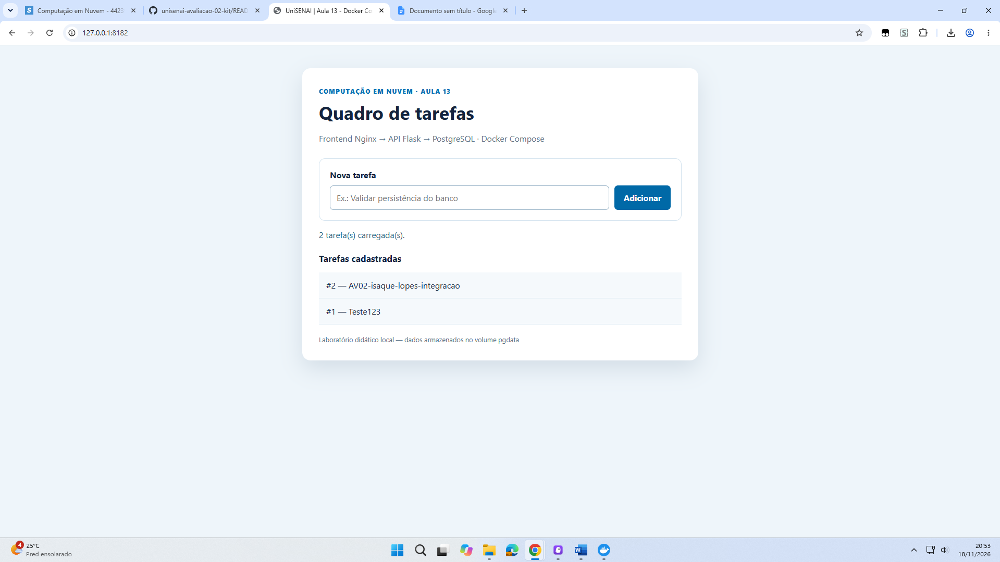
depois: 

PS C:\Users\isaque_m_lopes\Downloads\unisenai-avaliacao-02-kit-main> docker compose down
[+] Running 5/5
 ✔ Container unisenai-av02-isaque-lopes-frontend-1  Removed                                                                                 0.5s 
 ✔ Container unisenai-av02-isaque-lopes-backend-1   Removed                                                                                 0.5s 
 ✔ Container unisenai-av02-isaque-lopes-db-1        Removed                                                                                 0.3s 
 ✔ Network unisenai-av02-isaque-lopes_data_net      Removed                                                                                 0.2s 
 ✔ Network unisenai-av02-isaque-lopes_web_net       Removed                                                                                 0.5s 
PS C:\Users\isaque_m_lopes\Downloads\unisenai-avaliacao-02-kit-main> docker compose up -d
[+] Running 5/5
 ✔ Network unisenai-av02-isaque-lopes_data_net      Created                                                                                 0.0s 
 ✔ Network unisenai-av02-isaque-lopes_web_net       Created                                                                                 0.0s 
 ✔ Container unisenai-av02-isaque-lopes-db-1        Healthy                                                                                 6.1s 
 ✔ Container unisenai-av02-isaque-lopes-backend-1   Healthy                                                                                11.8s 
 ✔ Container unisenai-av02-isaque-lopes-frontend-1  Started                                                                                11.9s 

## E06 - Falha controlada e recuperação
- Com db parado: /api/live = ___ e /api/ready = ___
- Qual log ou sinal investiguei:
- Após o start do db: /api/ready = ___
- Evidência anexada:

PS C:\Users\isaque_m_lopes\Downloads\unisenai-avaliacao-02-kit-main> docker compose stop db
[+] Stopping 1/1
 ✔ Container unisenai-av02-isaque-lopes-db-1  Stopped                    
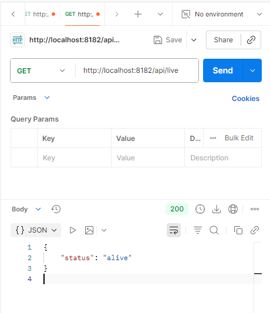
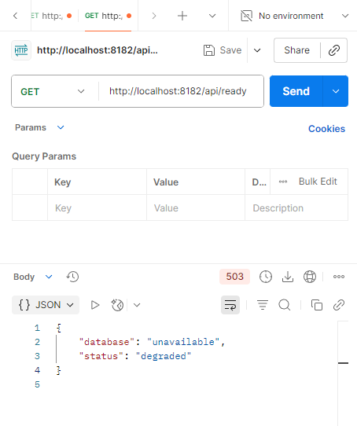

PS C:\Users\isaque_m_lopes\Downloads\unisenai-avaliacao-02-kit-main> docker compose ps
NAME                                    IMAGE                                 COMMAND                  SERVICE    CREATED         STATUS            PORTS
unisenai-av02-isaque-lopes-backend-1    unisenai-av02-isaque-lopes-backend    "gunicorn --bind 0.0…"   backend    6 minutes ago   Up 6 minutes (unhealthy)   8000/tcp
unisenai-av02-isaque-lopes-frontend-1   unisenai-av02-isaque-lopes-frontend   "/docker-entrypoint.…"   frontend   6 minutes ago   Up 6 minutes (healthy)     127.0.0.1:8182->80/tcp
PS C:\Users\isaque_m_lopes\Downloads\unisenai-avaliacao-02-kit-main> docker compose logs --tail=40 backend
backend-1  |   File "/app/app.py", line 14, in db_connect
backend-1  |     return psycopg.connect(
backend-1  |            ^^^^^^^^^^^^^^^^
backend-1  |   File "/usr/local/lib/python3.12/site-packages/psycopg/connection.py", line 96, in connect
backend-1  |     attempts = conninfo_attempts(params)
backend-1  |                ^^^^^^^^^^^^^^^^^^^^^^^^^
backend-1  |   File "/usr/local/lib/python3.12/site-packages/psycopg/_conninfo_attempts.py", line 53, in conninfo_attempts
backend-1  |     raise e.OperationalError(str(last_exc))
backend-1  | psycopg.OperationalError: [Errno -2] Name or service not known
backend-1  | 127.0.0.1 - - [18/Nov/2026:23:58:33 +0000] "GET /api/health HTTP/1.1" 503 47 "-" "Python-urllib/3.12"
backend-1  | Database healthcheck failed
backend-1  | Traceback (most recent call last):
backend-1  |   File "/app/app.py", line 27, in health
backend-1  |     with db_connect() as conn:
backend-1  |          ^^^^^^^^^^^^
backend-1  |   File "/app/app.py", line 14, in db_connect
backend-1  |     return psycopg.connect(
backend-1  |            ^^^^^^^^^^^^^^^^
backend-1  |   File "/usr/local/lib/python3.12/site-packages/psycopg/connection.py", line 96, in connect
backend-1  |     attempts = conninfo_attempts(params)
backend-1  |                ^^^^^^^^^^^^^^^^^^^^^^^^^
backend-1  |   File "/usr/local/lib/python3.12/site-packages/psycopg/_conninfo_attempts.py", line 53, in conninfo_attempts
backend-1  |     raise e.OperationalError(str(last_exc))
backend-1  | psycopg.OperationalError: [Errno -2] Name or service not known
backend-1  | 127.0.0.1 - - [18/Nov/2026:23:58:43 +0000] "GET /api/health HTTP/1.1" 503 47 "-" "Python-urllib/3.12"
backend-1  | Database healthcheck failed
backend-1  | Traceback (most recent call last):
backend-1  |   File "/app/app.py", line 27, in health
backend-1  |     with db_connect() as conn:
backend-1  |          ^^^^^^^^^^^^
backend-1  |   File "/app/app.py", line 14, in db_connect
backend-1  |     return psycopg.connect(
backend-1  |            ^^^^^^^^^^^^^^^^
backend-1  |   File "/usr/local/lib/python3.12/site-packages/psycopg/connection.py", line 96, in connect
backend-1  |     attempts = conninfo_attempts(params)
backend-1  |                ^^^^^^^^^^^^^^^^^^^^^^^^^
backend-1  |   File "/usr/local/lib/python3.12/site-packages/psycopg/_conninfo_attempts.py", line 53, in conninfo_attempts
backend-1  |     raise e.OperationalError(str(last_exc))
backend-1  | psycopg.OperationalError: [Errno -2] Name or service not known
backend-1  | 127.0.0.1 - - [18/Nov/2026:23:58:53 +0000] "GET /api/health HTTP/1.1" 503 47 "-" "Python-urllib/3.12"

PS C:\Users\isaque_m_lopes\Downloads\unisenai-avaliacao-02-kit-main> docker compose start db
[+] Running 1/1
 ✔ Container unisenai-av02-isaque-lopes-db-1  Started

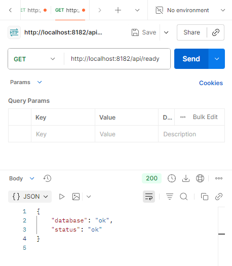

## E07 - Justificativa técnica
1. Por que somente o frontend publica uma porta no host?
Resposta: Por questão de segurança. Se outros serviços como o backend publicasse poderia comprometer a aplicação.

2. Por que .env não deve ser tratado como cofre de segredos?
Resposta: O arquivo `.env` contém credenciais de acesso, como usuários, senhas, chaves de API e outras informações sensíveis. Caso seja publicado ou disponibilizado publicamente, essas informações poderão ser comprometidas, colocando em risco a segurança de toda a aplicação e dos serviços integrados.

3. depends_on: service_healthy resolve indisponibilidade posterior do banco?
Resposta: Não. Essa condição só controla a ordem de inicialização. O Compose espera o healthcheck do banco passar antes de iniciar o serviço dependente.

4. Volume nomeado é o mesmo que backup externo? Justifique.
Resposta: Não. Volume nomeado não persiste os dados, backup externo é uma cópia separada, em outro local.

## Checklist final
- [ ] compose.yaml final
- [ ] backend/app.py final
- [ ] .env.example com valores estritamente fictícios
- [ ] relatorio_evidencias.md preenchido
- [ ] Evidências E01-E06
- [ ] Sem .env nem dados sensíveis
